# 舞萌听歌大作战 · maimai Song Quiz

从 **1,294 首舞萌 DX 可玩曲目** 中实时随机裁切片段，听歌识曲的粉丝向小游戏。
包含单人四种玩法、全服排行榜、以及 2–8 人实时联机对战。

参考：[LL 听歌大作战](https://playsnowgames.site/games/lovelive-song-battle/) 的信息架构与交互节奏，曲库、视觉与玩法按舞萌 DX 重做。

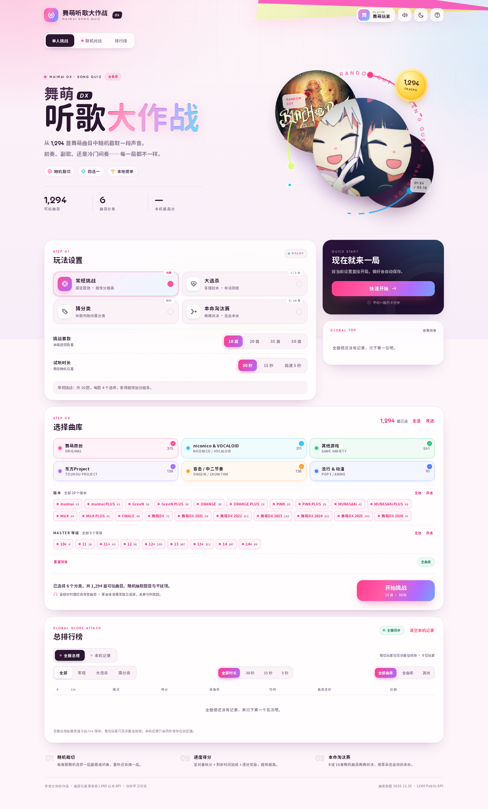

| 猜题（无曲绘 / 无 BPM） | 联机结算 |
|---|---|
| 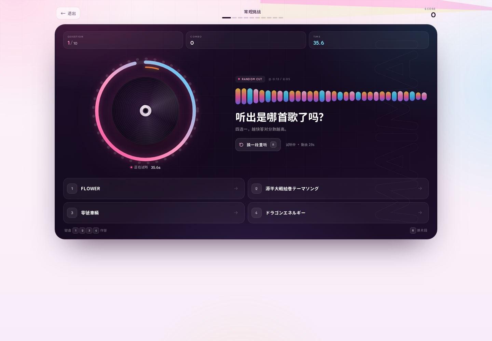 | 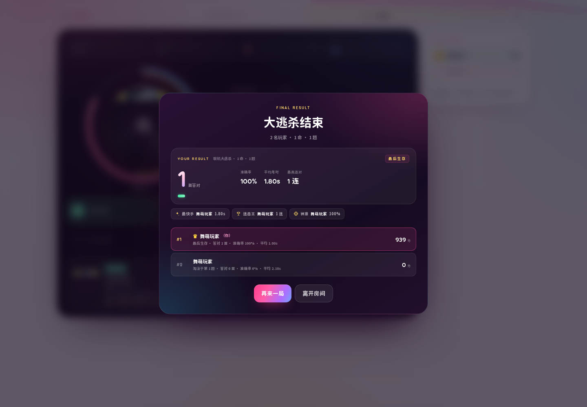 |
| 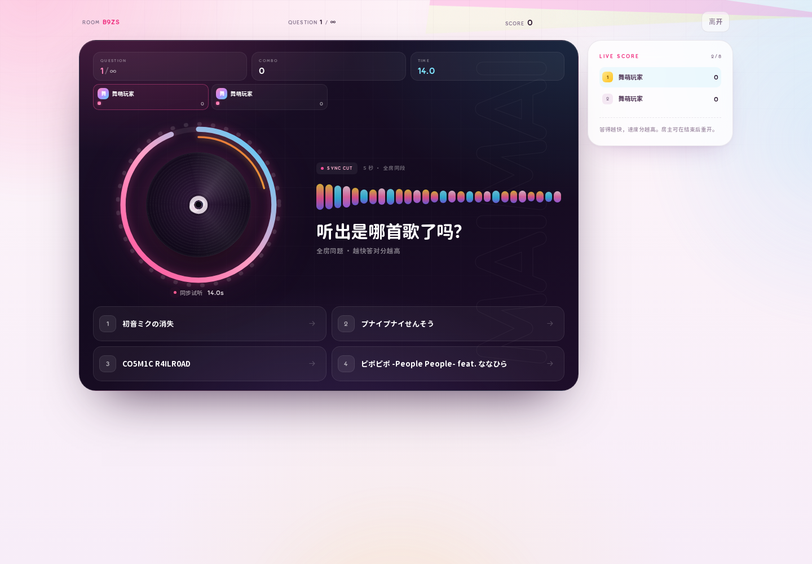 | 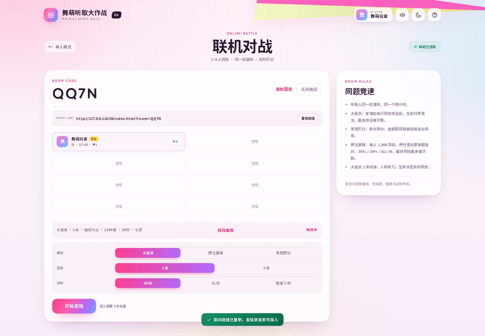 |

移动端（390×844）：黑胶盘面缩到 128px，与均衡器/题目并排；房间收起空位，开始按钮直接可见。联机玩家状态固定 **4 列 × 最多 2 行**（1–4 人一行，5–8 人两行），不再按屏宽压成两列。

| 移动端猜题 | 移动端联机 | 移动端房间 |
|---|---|---|
| 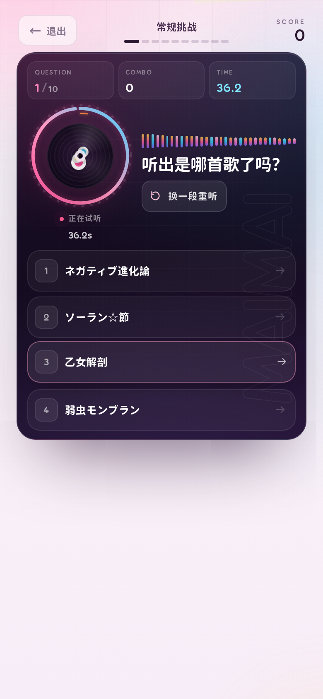 | 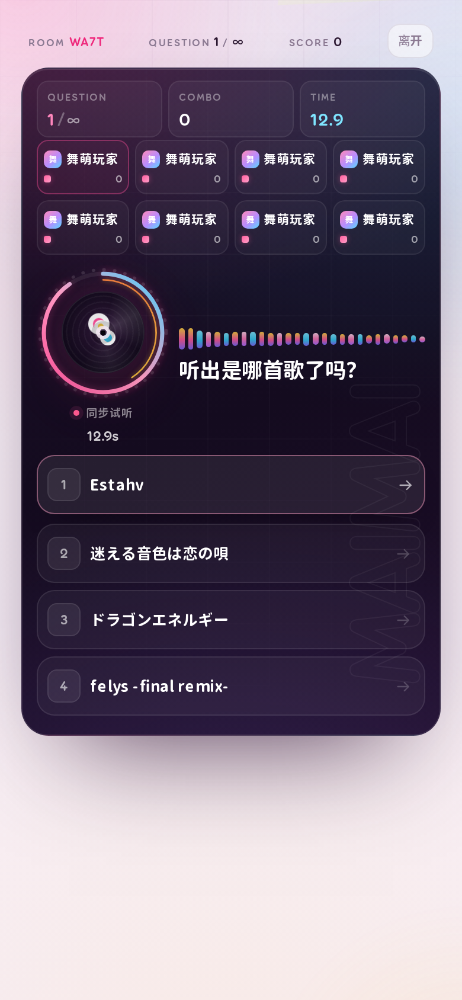 | 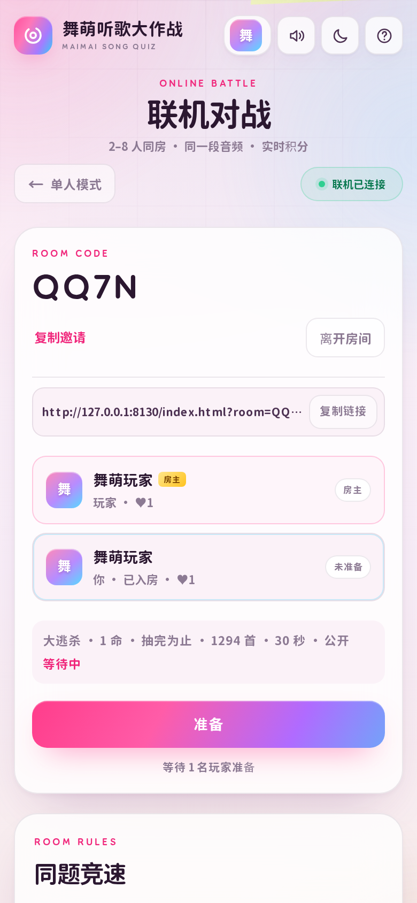 |

| 押注豪赌 | 押注结算 |
|---|---|
| 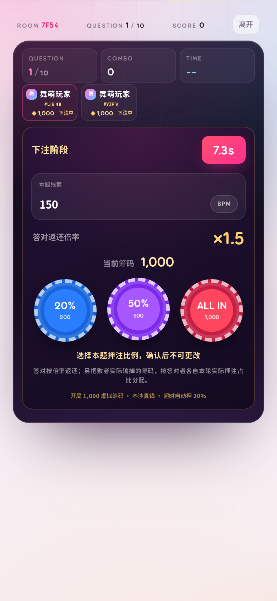 | 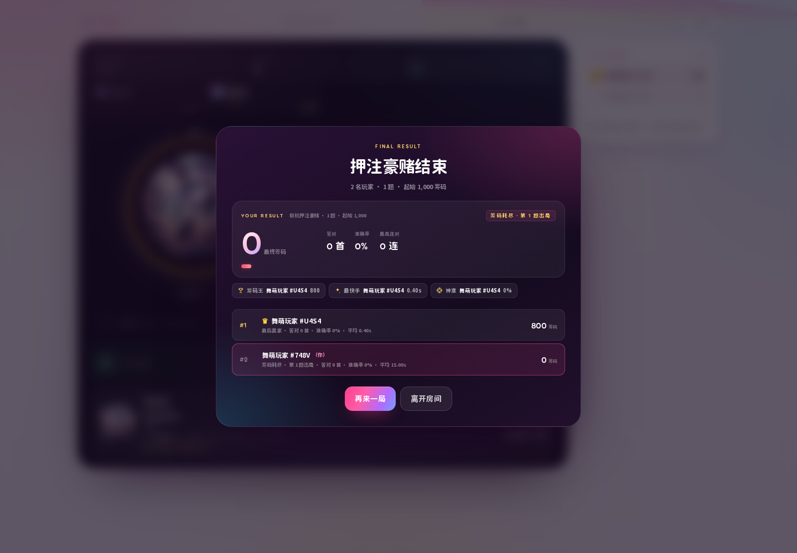 |

| 曲库多选（版本 / MASTER 等级） | 房间曲库多选 |
|---|---|
| 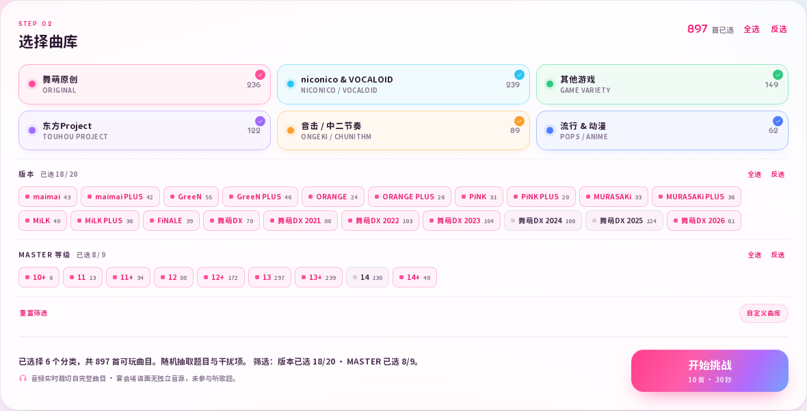 | 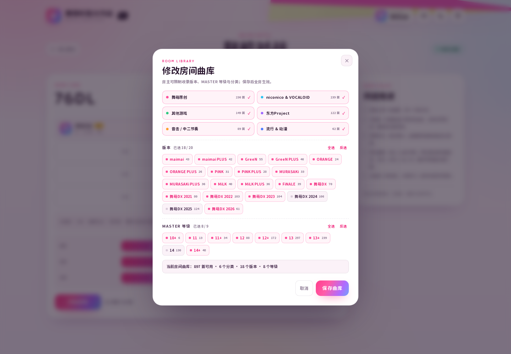 |

| 断线重连 |
|---|
| 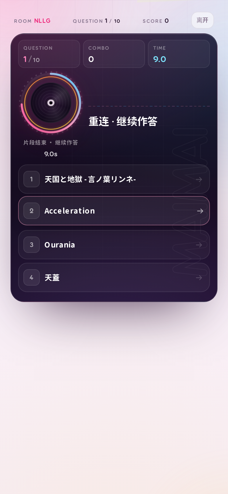 |

## 功能

- **完整曲库 + 精细筛选**：1,294 首可玩曲目 / 6 个分类，来自 LXNS 公共 API 的全量曲库；可按收录版本、MASTER 等级和分类多选筛选，实时重算可选题池。宴会場 65 个谱面因无独立音源不参与听歌题；另有 1 首标题只含空白/引号的曲目不进入听歌题。
- **真实随机裁切**：音频直接流式播放完整曲目，每题在曲目内随机选一段（`startPct` 随机），重听也会换一段；没有预生成片段。
- **四种单人玩法**
  - 常规挑战：10 / 20 / 35 / 50 题，速度分 + 连对奖励。
  - 大逃杀：从曲库里不断抽歌，答错扣命，直到曲库抽完或生命耗尽；1 命为标准排位，3 命为练习（不计榜）。
  - 猜分类：从已选分类中判断曲目所属分类（至少 4 个分类）。
  - 本命淘汰赛：8 / 16 首两两对决，选出你的本命。
- **全服总榜**：Node.js + SQLite；按每位玩家最佳成绩展示，支持模式、试听时长，以及**全曲库 / 其他曲库**分开排名。
- **联机对战**：2–8 人房间，默认**大逃杀**；也可切常规积分或**押注豪赌**。同题同步音频与倒计时；大逃杀答错扣血并同步全房，生命归零淘汰，最后存活者获胜；支持 1 命标准 / 3 命练习。服务端统一生成题目与判分。
- **联机顶栏状态**：固定 4 列 × 最多 2 行。大逃杀显示每位玩家的血量方块；押注豪赌显示筹码。扣血 / 淘汰 / 筹码实时同步。
- **押注豪赌**：每人起始 1,000 筹码；每题先进入下注阶段，显示分类 / 版本 / BPM 三选一的单条线索与 ×1.5 返还倍率，只能押自己本题答对，20% / 50% / ALL IN，超时自动押 20%；然后进入猜歌阶段。答对按 1.5 倍返还，并把败者实际输掉的筹码按答对者押注占比分配；筹码归零直接淘汰（显示 OUT），只剩一人立即结束；否则所选题数结束后筹码最多者获胜。
- **房间曲库**：房主可在房间内修改分类、收录版本和 MASTER 等级，保存后全房生效。
- **房间链接**：房间页直接显示邀请链接（`?room=房间码`），一键复制；对方打开后自动进入联机并加入房间。地址栏也会同步房间码，离开时清除。
- **断线重连**：临时切后台或网络波动导致 WebSocket 断开时，服务端保留座位 **5 分钟**；客户端自动重连并回到房间，也可刷新页面/打开房间链接重新坐下。重连回到当前题时，会带剩余时间和音频进度继续作答；如果一直没回来，本题按正常超时扣分（大逃杀扣命）。
- **设备显示 ID**：每位玩家显示「CN #随机ID」，例如「舞萌玩家 #A7K3」；ID 由本机 clientId 派生并固定，一台设备一个。
- **联机结算**：大逃杀最终排名与「最后生存 / 淘汰于第 X 题」、个人答对数 / 准确率 / 平均用时 / 最高连对、逐题绿红点、最快手 / 连击王 / 神准徽章。
- **结算卡**：Canvas 生成 1080×1350 图片，可保存分享；本命卡同理。
- **本地记录**：即使没有后端，也会用 localStorage 保存本机成绩。
- **细节**：深浅色主题、音效开关、键盘作答、移动端紧凑布局、随机曲绘兜底。

## 快速开始

要求 **Node.js ≥ 22.5**（使用内置 `node:sqlite` 与 `ws`）。

```bash
npm install
npm start
# 打开 http://localhost:8130
```

也可以用环境变量 / 参数改端口：

```bash
PORT=8090 HOST=127.0.0.1 node server.mjs
node server.mjs --port 8130 --host 0.0.0.0
DB_PATH=/var/lib/mai-quiz.sqlite node server.mjs
```

首次启动会自动创建 `data/leaderboard.sqlite` 和表结构。

### 纯静态模式

如果只把 `index.html` / `assets` 放到静态服务器（例如 `python3 -m http.server`），页面仍然可以玩：

- 单人模式、本命淘汰赛、结算卡正常。
- 全服榜自动退回「本机记录」。
- 联机对战显示「联机服务未连接」。

静态服务器示例：

```bash
python3 -m http.server 8123
# 打开 http://localhost:8123
```

## 联机对战

1. 大厅点「联机对战」。
2. 创建房间：默认**大逃杀**，选择 1 命 / 3 命 与试听时长；也可以切到常规积分或押注豪赌。公开房会出现在房间大厅；复制房间页的邀请链接发给朋友，打开会自动加入。
3. 其他玩家点「准备」，房主点「开始游戏」。
4. 服务端生成四选一题目，全房收到同一首歌、同一段 `startPct`、同一个倒计时；每 700 ms 同步启动音频。
5. 大逃杀中答错会扣血，扣血和淘汰状态会实时同步到所有人的侧栏；生命归零即淘汰，最后一名存活者获胜。
6. 结算展示最终排名；房主可以「再来一局」。

房主在等待页可以打开「修改曲库」，按分类 / 版本 / MASTER 等级缩小房间题库；全房会看到新的曲库大小，曲库不足 4 首时无法开始。房主还可以踢出玩家（被踢玩家回大厅，房间未开始时可用房间码/链接重新加入），并可在创建房间后随时切换公开/私人：私人房不出现在大厅，但房间码与邀请链接仍然可用。

技术要点：

- WebSocket 端点：`/ws`。
- 房间状态在服务端内存中；服务重启会清空未结束的房间。
- 客户端在 `game:question` 阶段预加载音频并回 `game:ready`；服务端等待全体就绪或 4 秒超时后开始。重连用 `game:resync` 同步当前题、剩余时间和音频 offset。
- 判分、正确项、题目全部在服务端，客户端只负责播放与展示。
- 支持断线重连（座位保留 5 分钟）；暂不支持观战、聊天；主动离开房间会从当前局移除。
- 同一房间最多 8 人；同一服务最多 100 个房间。

## 全服排行榜

### 表结构

见 [`db/schema.sql`](db/schema.sql)。核心字段：

| 字段 | 说明 |
| --- | --- |
| `client_id` | 浏览器本地生成的匿名 ID，用于「每位玩家最佳成绩」去重 |
| `cn` | 玩家昵称 |
| `mode` | `challenge` / `royale` / `genre` |
| `clip` | 5 / 15 / 30 秒 |
| `question_count` / `answered` | 计划题数 / 实际作答数（大逃杀为存活题数） |
| `scope` | `full`（全曲库）/ `custom`（筛选后的其他曲库） |
| `pool_size` | 本局实际曲库大小 |
| `score` / `accuracy` / `avg_time` / `max_combo` | 成绩 |
| `created_at` | ISO 时间 |

### API

```http
GET /api/leaderboard?mode=all&clip=all&scope=all&limit=50
GET /api/health
POST /api/leaderboard
Content-Type: application/json
```

POST 示例：

```json
{
  "clientId": "2f1d3a4b-...",
  "cn": "舞萌玩家",
  "mode": "challenge",
  "scope": "full",
  "clip": 30,
  "count": 10,
  "answered": 10,
  "correct": 8,
  "score": 8000,
  "accuracy": 80.0,
  "avgTime": 2.5,
  "maxCombo": 5,
  "poolSize": 1294
}
```

服务端会校验：

- 字段范围、模式、时长、题数。
- 常规 / 猜分类必须完成全部题目；大逃杀允许提前结束。
- 准确率必须与 `correct / answered` 一致。
- `score ≤ answered × 1200`（单题理论上限 1200）、`maxCombo ≤ correct`。
- 同一 `clientId` 两次提交间隔至少 3.5 秒。
- 参数化 SQL；静态服务不暴露 `data/` 与数据库文件。

返回：

```json
{ "ok": true, "id": 12, "rank": 3, "total": 8 }
```

### 部署到 Cloudflare Workers

完整迁移说明、D1 / Durable Object 适配、部署与验收清单见：

- **[docs/cloudflare-workers-migration.md](docs/cloudflare-workers-migration.md)**

简要流程：

```bash
npm i -D wrangler
npx wrangler login
npx wrangler d1 create mai-quiz
# 把 database_id 填进 wrangler.toml（从 wrangler.toml.example 复制）
npx wrangler d1 execute mai-quiz --remote --file=db/schema.d1.sql
npm run build:cf
npx wrangler deploy
```

要点：

- D1 建表用 **`db/schema.d1.sql`**，不要直接导 Node 版 `db/schema.sql`（后者含
  `PRAGMA journal_mode`，D1 不需要）。
- 静态资源由 **Workers Assets** 托管，来源是 `npm run build:cf` 生成的 `public/`。
- 联机建议先用**一个全局 `RoomHub` Durable Object** 承接所有房间，协议不变；
  有并发压力后再拆成一房一个 DO。
- `assets/js/config.js` 同域部署时不用改；静态和 API 分开部署时再填完整地址。

## 数据与音源

- 曲库元数据来自 **LXNS 公共 API**：
  - `https://maimai.lxns.net/api/v0/maimai/song/list`
  - `https://maimai.lxns.net/api/v0/maimai/alias/list`
- 游戏资源来自 **LXNS 游戏资源 CDN**：
  - 音频：`https://assets2.lxns.net/maimai/music/{id}.mp3`（完整曲目，支持 Range / CORS）
  - 曲绘：`https://assets2.lxns.net/maimai/jacket/{id}.png`
- 更新曲库：
  ```bash
  npm run sync
  ```
  会重新请求 LXNS 并生成 `assets/js/data.js`。服务端会复用这份数据。
- 音频不是预生成切片：浏览器通过 `<audio>` + Range 请求定位到随机起点，因此每次播放的片段位置都可能不同。

## 目录结构

```text
.
├── index.html                 # 全部界面（单人 / 联机 / 排行榜 / 结算）
├── assets/
│   ├── css/style.css
│   ├── js/
│   │   ├── data.js            # 自动生成的全量曲库
│   │   ├── audio.js           # 完整曲目播放、随机裁切、联机 prepare
│   │   ├── app.js             # 单人、排行榜、联机客户端
│   │   └── config.js          # 可选部署配置（API / WS 地址）
│   ├── fonts/                 # Torus + 子集化的 Resource Han Rounded
│   └── img/                   # maimai 风格装饰与 favicon
├── server.mjs                 # 静态站 + SQLite 排行榜 + WebSocket
├── server/
│   ├── catalog.mjs            # 复用 data.js 的服务端曲库
│   └── rooms.mjs              # 联机房间与出题 / 判分
├── db/
│   ├── schema.sql             # Node SQLite schema
│   └── schema.d1.sql          # Cloudflare D1 schema（无 WAL PRAGMA）
├── tools/
│   ├── sync-data.mjs          # LXNS 数据同步
│   └── build-cf.mjs           # 生成 public/ 与 worker/catalog.json
├── docs/
│   ├── cloudflare-workers-migration.md
│   └── github-publish.md
├── wrangler.toml.example      # Cloudflare 配置模板
└── data/leaderboard.sqlite    # 运行时生成（已 gitignore）
```

## 后续

- 自由观战、聊天和 Durable Object 化。
- 全服榜的 Turnstile / 域名限流。

## 已知限制

- 联机房间只存在内存中，服务重启会清空；断线后座位保留 5 分钟，超时才会移除。暂不支持自由观战与聊天。
- 曲绘与音频依赖 LXNS CDN，需要网络；CDN 限流时会提示重试。
- 宴会場（utage）谱面没有独立音频，不参与听歌题。
- 全服榜是匿名 `clientId` 去重，无法阻止清空 localStorage 后换身份；公网运营请自行加验证与限流。
- 本项目不是 SEGA 官方产品。

## 声明

非官方粉丝作品，仅供学习交流。maimai / 舞萌 DX 及相关曲目、曲绘、商标归 SEGA 与各权利人所有。
曲目数据与游戏资源通过 LXNS 公共 API 获取；如果权利人要求，请停止使用并删除相关内容。
